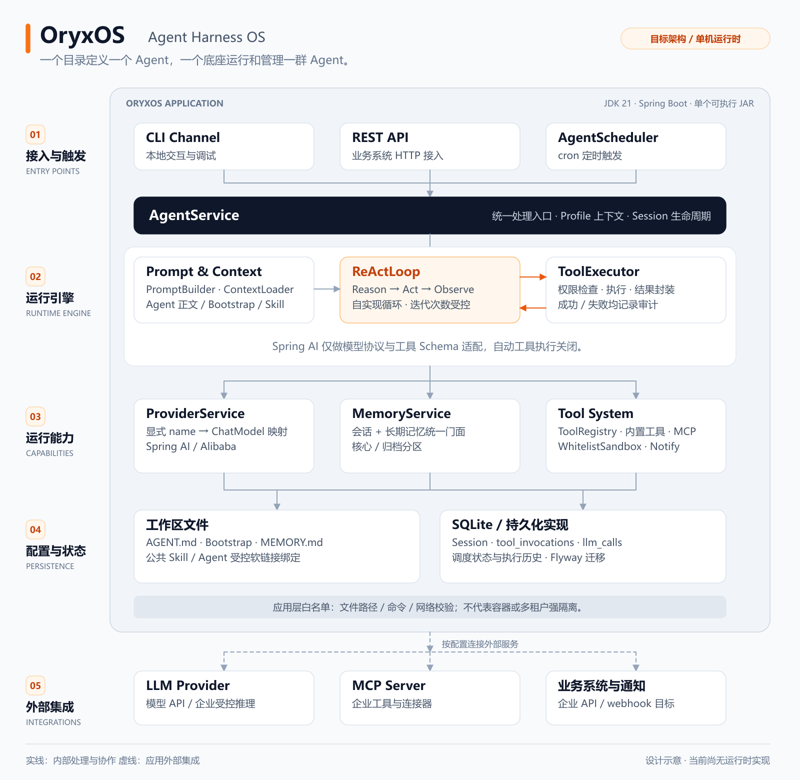

# OryxOS

<p align="center">
  
</p>

<p align="center">
  <strong>用自然语言定义任务，让 Agent 为企业工作。</strong><br/>
  <em>企业私有部署的 Agent 操作系统 · Agent Harness OS</em>
</p>

<p align="center">
  Java 21 · Spring Boot · MCP · 自实现 ReAct · 私有部署
</p>

---

**OryxOS 致力于成为企业自己的 Agent 操作系统。** 业务方用一个 Markdown 目录定义 Agent，底座提供模型接入、推理循环、记忆、工具、定时任务与对外服务，让多个业务 Agent 共享一套运行环境。

**一个目录定义一个 Agent，一个底座运行和管理一群 Agent。**

- **当前重点**：构建单机运行时内核，跑通 Provider、ReAct、Memory、Tool、Web Service 五大核心能力。
- **长期愿景**：用户用一句自然语言发布任务，底座组织 Agent 团队，跨角色、跨节点协作交付结果。

> **开发状态**：已按核心阶段的 9 模块结构建立 Maven 工程，提供最小 Spring Boot 与 CLI 启动入口。Agent 推理、记忆、工具与 REST 业务端点仍待实现；下述产品能力为目标设计，构建产物尚非完整 Agent OS。
>
> 长期目标：走进 Apache 基金会，努力成为 Apache 顶级项目。

[项目介绍](docs/oryxos.md) · [技术方案](docs/TechnicalSolution.md) · [快速开始](#快速开始) · [参与贡献](#参与贡献)

## Agent 公式

> **自然语言（Markdown）+ Memory + Tool + MCP + Skill + 知识库 + Notify = 一个 Agent**

Agent 描述业务意图，底座提供运行能力。任务指令、模型选择、工具范围和触发方式通过配置组合，避免为每个业务 Agent 重复开发一套后端。

这条公式描述的是完整能力方向；首个运行时内核优先完成五大核心能力，知识库和其他扩展按阶段推进。

## 什么是 Agent Harness，为什么需要 OS

**Agent Harness 是模型外面的运行骨架，让模型具备执行任务的能力。** 它驱动 reason → act → observe 循环，组装上下文，执行工具，维护记忆，并记录每次调用的过程。

当企业运行多个 Agent 时，还需要统一管理它们的定义、生命周期、渠道、工具和调度。OryxOS 将单个 Agent 的运行骨架与多个 Agent 共用的基础设施结合起来，形成 Agent Harness OS。

## Model → Harness → OS

| 维度 | 裸模型 | Agent Harness | Agent Harness OS |
| --- | --- | --- | --- |
| 范围 | 一次 LLM 调用 | 一个能执行任务的 Agent | 多个被运行和管理的 Agent |
| 提供能力 | 文本生成与工具调用意图 | 推理循环、工具执行、上下文、记忆与审计 | 生命周期、渠道、共享注册表、调度、API 与治理 |
| 类比 | 一条计算指令 | 一个进程的运行环境 | 管理多个进程的操作系统 |

OryxOS 的产品目标是第三列，先把第二列所需的运行时内核做扎实，再逐步建设治理与协作能力。

## 核心特性

**🤖 一个目录 = 一个 Agent**

Agent 定义位于 `.oryxos/agents/<name>/AGENT.md`：frontmatter 描述运行配置，正文描述任务指令。多个 Agent 可以在同一个底座上配置和运行。

**🧩 Skill 渐进式披露**

公共 Skill 保存在 `.oryxos/skills/`，Agent 通过受控相对软链接绑定。Prompt 只预注入已绑定 Skill 的名称、描述和本地路径，正文与附属资源按需读取。

**📦 单进程部署，复用 Java 体系**

基于 JDK 21 和 Spring Boot，采用同步阻塞与 Virtual Thread，目标产物为单个可执行 JAR。CLI、REST 与定时任务共用运行引擎。

**🔒 企业自主部署与接入**

面向企业自己的 K8s、虚拟机或物理机，模型和工具服务由部署方选择。数据不出域的部署需要使用满足要求的本地或企业受控服务。

**🔀 统一模型路由**

Provider 名称显式映射到模型实现，Agent 通过配置选择模型，底层协议适配复用 Spring AI / Spring AI Alibaba。

**🛡️ 执行约束与结构化审计**

工具执行校验文件路径、命令与网络白名单；工具调用和模型调用写入审计表。核心阶段的白名单属于应用层校验，不提供容器级或多租户强隔离。

**🔌 开放标准与三档扩展**

复用现成 MCP Server、自建 MCP Server、Java `@Tool` 三种方式覆盖不同接入深度；Notify 提供按名称引用的出站通知，A2A 是后续 Agent 协作方向。

## 架构

目标形态是一个 Spring Boot 单体应用。不同触发源统一进入 `AgentService`，由自实现的 ReAct 循环协调模型、记忆和工具。



[查看 SVG 矢量原图](docs/images/architecture.svg)

Spring AI 负责模型协议转换与工具 Schema 生成，自动工具执行必须关闭；实际调用由 OryxOS 的 `ReActLoop` 与 `ToolExecutor` 控制。

## 五大核心能力

| 能力 | 设计说明 |
| --- | --- |
| **LLM Provider** | 统一模型接入，使用显式 provider name → ChatModel 映射，屏蔽不同模型厂商的协议差异。 |
| **ReAct 循环** | 模型判断是否调用工具，OryxOS 执行并回填结果，再由模型决定下一步；支持最大迭代限制与完整消息累积。 |
| **Memory** | 统一管理会话和长期记忆；长期记忆采用核心/归档分区，默认 Markdown 后端，接口支持 SQLite、自托管 Mem0 等可插拔方案。 |
| **Tool 体系** | 内置文件、Shell、HTTP、Memory 与 Notify 工具，统一适配 MCP 和 Java 工具；Profile 限定工具可见范围。 |
| **Web Service** | 通过 REST API 提供会话管理、Agent 调用、Profile、Memory、Tool 与系统状态查询，支持跨语言业务系统集成。 |

知识库、人格库和 IM 渠道已进入扩展模块设计，不改变五大核心能力的主线。

## 路线图

**阶段一：单机运行时内核（当前建设方向）**

完成五大能力，实现配置定义 Agent、多 Agent 并存、CLI / REST / 定时触发、MCP、基础白名单和审计。当前已具备设计文档和 9 模块工程骨架，业务能力实现待推进。

**阶段二：底座分布式**

将状态外置，逐步实现多副本、高可用、水平扩展与调度协调。

**阶段三：跨节点 Agent 协作**

引入 Agent 发现、委托与可靠通信，对接 A2A，向自然语言驱动的 Agent 团队协作演进。

**持续演进的能力方向**

- IM 渠道、知识库、人格库和 Web 管理。
- 长期记忆检索升级与可插拔存储。
- 容器 / MicroVM 等更强执行隔离。
- 多租户、SSO、RBAC、工具策略、成本与可观测性治理。

主体开发依赖顺序为 `Provider → ReAct →（Memory / Tool）→ Web Service`。整体验收围绕每日天气、每日科技日报和每日 GitHub 日报三个场景展开，详见 [技术方案：关键流程](docs/TechnicalSolution.md#12-关键流程)。

## 模块结构

本次按核心阶段的 **9 个 Maven 模块**初始化。根 `pom.xml` 负责版本、依赖与模块聚合，模块之间通过依赖边界组织：

```text
agentos_oryxos/
├── pom.xml                  # Maven 父工程，io.oryxos:oryxos:0.1.0-SNAPSHOT
├── oryxos-core              # 领域契约与运行时基础
├── oryxos-provider          # 模型 Provider 适配
├── oryxos-memory            # 记忆门面与后端
├── oryxos-tool              # 内置工具、MCP、Sandbox 与 Notify
├── oryxos-channel-cli       # 本地交互渠道
├── oryxos-storage           # 持久化适配
├── oryxos-web               # Spring MVC / REST 接入
├── oryxos-cli               # Picocli 入口，当前支持 --help / --version
└── oryxos-boot              # Spring Boot 启动与依赖聚合
```

`core` 不依赖边缘实现，`boot` 聚合其余模块。`cli` 保留普通依赖 JAR，并额外生成带 `exec` 后缀的可执行 JAR，供独立启动。

技术方案的 14 模块完整目标还包括人格、知识库及飞书、企微、钉钉渠道，本次暂不创建；各模块当前为工程骨架，不表示业务能力已经完成。

## 快速开始

### 1 · 了解项目

当前可以从以下文档进入项目：

| 文档 | 内容 |
| --- | --- |
| [项目介绍](docs/oryxos.md) | 定位、愿景与路线图 |
| [行业调研](docs/IndustryResearch.md) | 企业需求、生态定位与产品边界 |
| [需求文档](docs/DemandAnalysis.md) | 功能、数据模型与验收 |
| [技术方案](docs/TechnicalSolution.md) | 架构、模块与运行契约 |
| [AI 编程指南](docs/AiProgrammingGuide.md) | 规格驱动的主体开发与增量协作 |

### 2 · 编译与打包

要求 **JDK 21 或更高版本 + Maven 3.9+**，产物通过 `--release 21` 面向 Java 21 编译。开始实现前阅读 [开发协作指南](AGENTS.md)，使用 Claude Code 时同时阅读 [CLAUDE.md](CLAUDE.md)。

在仓库根目录执行：

```bash
mvn clean package
```

此命令编译并打包全部 9 个模块。业务测试将随实现补充，当前工程骨架不包含测试用例。

### 3 · 启动工程骨架

启动 Spring Boot 应用（默认端口 8080）：

```bash
java -jar oryxos-boot/target/oryxos-boot-0.1.0-SNAPSHOT.jar
```

独立启动 CLI 默认打印版本，也可查看帮助或显式查询版本：

```bash
java -jar oryxos-cli/target/oryxos-cli-0.1.0-SNAPSHOT-exec.jar
java -jar oryxos-cli/target/oryxos-cli-0.1.0-SNAPSHOT-exec.jar --help
java -jar oryxos-cli/target/oryxos-cli-0.1.0-SNAPSHOT-exec.jar --version
```

目前 Boot 只提供 Spring MVC 启动环境，尚无下文列出的业务 API；CLI 只支持帮助与版本。启动骨架无需数据库或模型凭证，`init`、`chat`、`serve`、`gateway` 等业务命令将在后续加入。

<details>
<summary>Windows / JDK 23 启动时出现本地套接字错误</summary>

若出现 `Unable to establish loopback connection` 和 `Invalid argument: connect`，可为 JVM 指定一个存在、可写且不含 Windows 短路径别名的本地套接字临时目录。本机 JDK 23.0.2 使用以下 PowerShell 命令已验证 HTTP 启动成功：

```powershell
java "-Djdk.net.unixdomain.tmpdir=$((Resolve-Path oryxos-boot/target).Path)" -jar oryxos-boot/target/oryxos-boot-0.1.0-SNAPSHOT.jar
```

此参数用于处理本机运行环境问题，未写入应用默认配置。

</details>

Web 管理台、Docker 镜像和一键启动脚本属于后续交付内容，当前没有对应运行入口。

## Agent 定义

**一个目录 = 一个 Agent。** Agent 的本体是 `.oryxos/agents/<name>/AGENT.md`，frontmatter 派生成 Profile，正文作为任务指令注入上下文。

以下为目标格式示意，尚未提供加载器运行该定义：

```markdown
---
name: ops-agent
description: 运维助手
identity:
  agent_name: ops-agent
  prompt: 你是一名运维助手，基于可验证的信息给出建议。
provider:
  name: deepseek
  model: deepseek-chat
tools:
  - read_file
  - http_get
  - save_memory
  - recall_memory
settings:
  max_iterations: 10
  max_history_turns: 20
---

帮助用户查询运维资料、分析系统状态并给出操作建议。
需要外部信息时使用已授权的工具；无法取得信息时明确说明。
```

Agent 可附带参考资料、脚本和 `skills/` 绑定视图：

```text
.oryxos/
├── agents/
│   └── ops-agent/
│       ├── AGENT.md
│       ├── skills/
│       │   └── ops-guide -> ../../../skills/ops-guide
│       ├── scripts/
│       └── REFERENCE.md
└── skills/
    └── ops-guide/
        └── SKILL.md
```

公共 Skill 实体与 Agent 定义分离，绑定关系只由受控相对软链接表达，不使用 frontmatter `skills:` 列表。每轮只预注入 Skill 元数据，正文通过 `read_file` 按需加载。

定时任务通过 Agent 的 `schedules` 声明。Agent 正文重读、Profile 重新注册、调度更新和文件监听分别按对应能力实现，不能将正文即时生效视为完整热部署已经可用。

## REST API

核心 API 设计使用 `/api/v1` 前缀，响应统一包含 `code`、`message`、`data` 与 `timestamp`。以下是首批 **10 个目标端点**，尚未实现：

| 方法 | 路径 | 用途 |
| --- | --- | --- |
| `POST` | `/api/v1/sessions` | 创建会话 |
| `POST` | `/api/v1/sessions/{id}/messages` | 发送消息并触发 ReAct |
| `GET` | `/api/v1/sessions/{id}` | 查询会话历史 |
| `DELETE` | `/api/v1/sessions/{id}` | 归档会话 |
| `POST` | `/api/v1/agents/{name}/invoke` | 无状态调用 Agent |
| `GET` | `/api/v1/profiles` | 查询派生 Profile |
| `GET` | `/api/v1/memory` | 查询长期记忆 |
| `GET` | `/api/v1/tools` | 查询可用工具 |
| `GET` | `/api/v1/health` | 健康检查 |
| `GET` | `/api/v1/info` | 查询系统信息 |

Agent CRUD、自然语言生成草稿、调度管理、通知渠道管理、工作区文件浏览和流式响应按后续任务增补，详细契约见 [技术方案](docs/TechnicalSolution.md)。

## 设计原则

- **底座优先于业务 Agent**：让不同 Agent 复用统一运行环境。
- **核心机制自主可控**：自实现 ReAct，底层模型协议复用成熟适配库。
- **配置即 Agent**：通过 `AGENT.md`、绑定 Skill 与工具配置组合业务能力。
- **对接开放标准**：工具采用 MCP，协作向 A2A 演进，避免另造生态协议。
- **为状态外置保留边界**：先实现单机，再按需求建设分布式存储和协调。
- **安全与审计进入架构**：最小工具可见范围、白名单、受控凭证与结构化调用记录；更强隔离随部署需求演进。
- **分阶段克制交付**：先完成可演示、可验证的最小运行时，避免一次引入全部扩展能力。

## 技术栈

| 组件 | 选型 |
| --- | --- |
| 语言 / 运行环境 | Java 21、Virtual Thread |
| 应用框架 / HTTP | Spring Boot 3.x、Spring MVC |
| 模型接入 | Spring AI / Spring AI Alibaba |
| 推理引擎 | 自实现 ReAct Loop |
| CLI | Picocli |
| 配置解析 | SnakeYAML |
| 关系数据 | SQLite 默认、PostgreSQL 可选；Spring Data JPA、Flyway |
| 长期记忆 | Markdown 默认，可插拔 SQLite / 自托管 Mem0 后端 |
| 工具协议 | MCP Java SDK |
| 日志 | SLF4J、Logback |
| 构建 | Maven 多模块 |

当前工程固定 Spring Boot `3.5.7`、Picocli `4.7.7`，Java 目标版本为 `21`。模型、数据库、MCP 等业务依赖将在对应能力实现时引入，避免骨架启动提前要求 API Key 或数据库配置。

## 参与贡献

欢迎贡献设计讨论、文档、代码和测试。开始前阅读 [AGENTS.md](AGENTS.md)，明确任务范围与验收方式；基于现有工程骨架，优先推进 Provider / ReAct 的最小链路。

每项贡献应说明解决的问题、具体改动、实际验证结果和未完成部分。行为变更覆盖关键成功与失败路径，文档变更核对结构和链接。大型功能沿用 [AI 编程指南](docs/AiProgrammingGuide.md) 的规格驱动流程，小型修复按实际需要开展。

OryxOS 来自 [oryx-labs](docs/oryx-labs.md) 社区，欢迎对 Agent、AI 基础设施和 AI Coding 感兴趣的开发者参与。

## 许可证

项目文档确定的许可证方向为 **Apache License 2.0**。当前仓库尚未包含正式的 `LICENSE` 文件，完整许可证文本待后续补齐。
